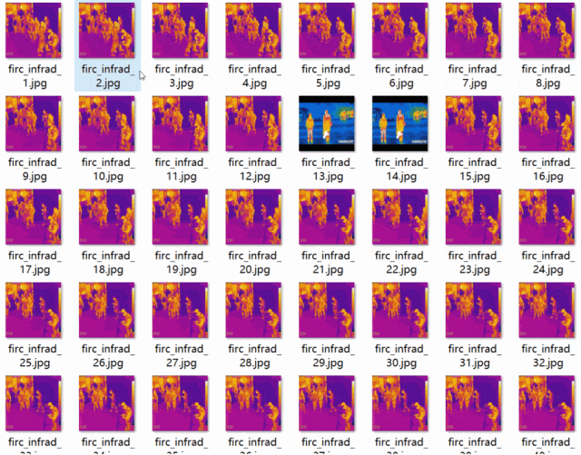
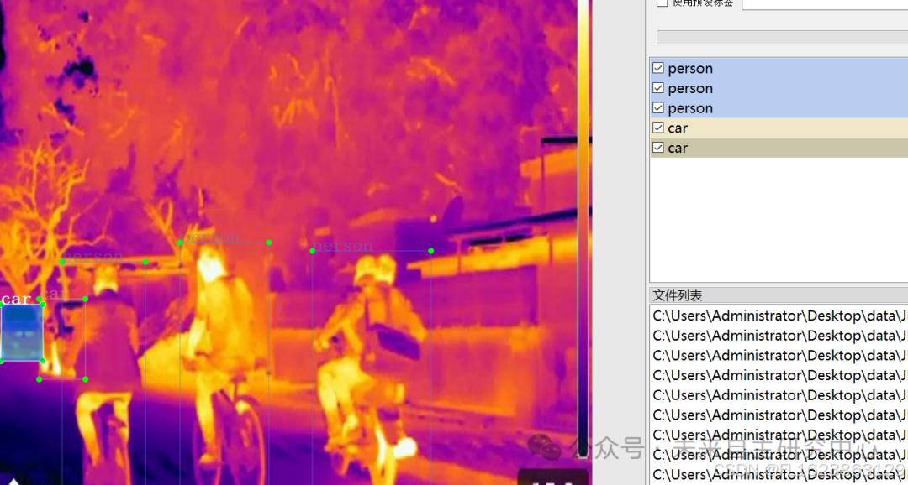

# [Dataset] [Object Detection] Infrared scene vehicle and pedestrian detection dataset VOC+YOLO format with 19069 images in 4 categories

Dataset format: Pascal VOC format + YOLO format (txt files without split paths, only containing jpg images and corresponding VOC format xml files and yolo format txt files)
Number of images (number of jpg files): 19069
Number of annotations (number of xml files): 19069
Number of annotations (number of txt files): 19069
Number of annotation categories: 4
Annotation category names: ["person", "car", "cat", "dog"]
Number of boxes per category:
person boxes = 46693
car boxes = 7851
cat boxes = 572
dog boxes = 2282
Total number of boxes: 57398
Labeling tool used: labelImg
Annotation rules: draw rectangle boxes for each category
Important note: No guarantee is made regarding the accuracy or weights of the trained models. The dataset provides accurate and reasonable annotations only.

Image Preview:

Annotation example:

## Payment

Here is a pay link on Stripe ( https://buy.stripe.com/3cs8yP7sY87d0vu9AB ). Please contact me lonlonago@foxmail.com after funding $89, and I will send you a complete data files , thank you!

